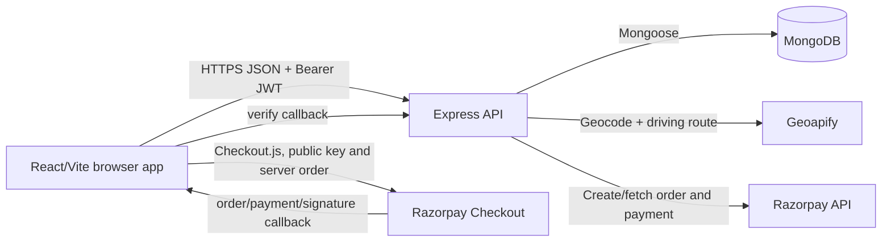
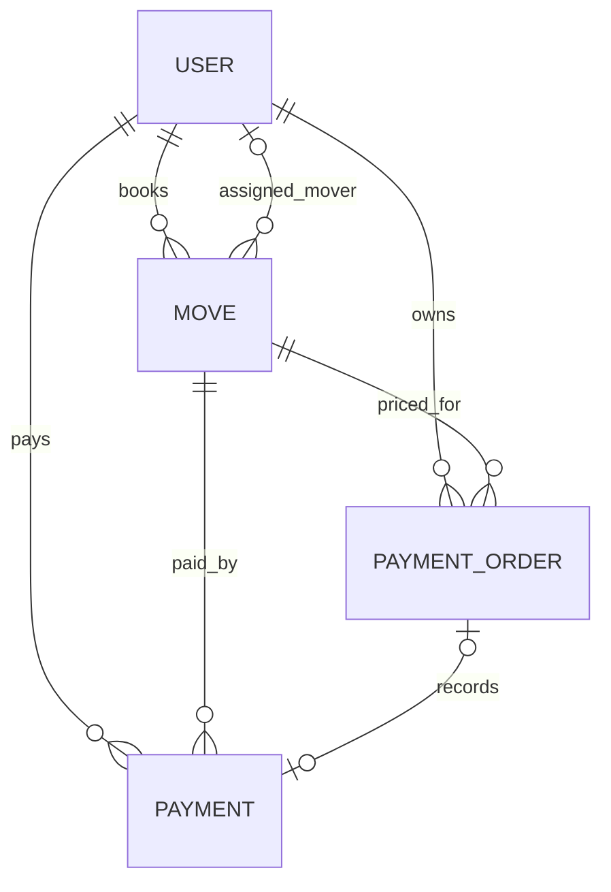

# SwiftMove Current-State Software Requirements Specification

**Document type:** As-built SRS  
**Basis:** Repository inspection of the current source tree  
**Status:** Describes implemented code; production behavior still requires runtime verification

## 1. Introduction

### 1.1 Project overview and purpose

SwiftMove is a browser-based moving and logistics application. Its current operational workflow lets customers register, request a move, obtain a backend-computed road-distance quote when pricing is configured, and pay through Razorpay. Movers can discover unassigned priced moves, accept one, and advance its status. Administrators can view aggregate statistics, users, movers, moves, and payments.

The repository also contains marketing pages and older service-request, provider, review, and order schemas/routes. Several of these are not mounted or connected to the current Move workflow. Their presence is not evidence of a functioning feature.

### 1.2 Scope

This specification records the current implementation only. It covers the React/Vite frontend, Express/Mongoose backend, current database models, mounted APIs, pricing and payment integrations, and observed gaps. It does not define future business rules or treat marketing copy as verified operational capability.

### 1.3 Current capabilities

- Customer and mover signup/login with JWT bearer authentication.
- Customer profile read/update and customer dashboard data.
- Move quote and move creation using server-side Geoapify geocoding and driving distance, provided all required pricing configuration is supplied.
- Move history and per-move retrieval for the owning customer.
- Razorpay order creation from the saved move price, payment signature validation, gateway status verification, and payment records.
- Mover job discovery, atomic move acceptance, assigned-job listing, and constrained status progression for explicitly approved mover accounts.
- Mover approval application/review flow with status stored on the existing `User` identity.
- Read-only administrator lists and aggregate dashboard statistics.
- Static public-facing service, solution, industry, and about pages.

### 1.4 Technology stack

| Layer | Current implementation |
|---|---|
| Frontend | React 18, React Router 6, Vite 6, Tailwind CSS, lucide-react |
| Backend | Node.js (package engine `>=18`), Express 4, CommonJS |
| Persistence | MongoDB through Mongoose 8 |
| Authentication | `jsonwebtoken`; passwords hashed with `bcryptjs` |
| Routing/distance | Geoapify Geocoding and Routing APIs called from the backend |
| Payments | Razorpay Node SDK and browser Checkout.js |
| Frontend hosting configuration | `Frontend/vercel.json` SPA rewrite; actual deployed state not verified |
| Backend hosting configuration | Render URL appears in CORS allowlist; deployment state not verified |

## 2. System Architecture

### 2.1 Architecture diagram



### 2.2 Frontend architecture

`Frontend/src/main.jsx` mounts the React application and `Frontend/src/router/index.jsx` defines a browser router with a shared layout. Public marketing/authentication pages are mixed with protected customer, mover, and administrator dashboards. `ProtectedRoute` checks a JWT and role decoded in browser storage for presentation routing; backend middleware independently enforces API authorization.

Frontend service modules call the shared `apiRequest` helper. It adds the stored bearer token, JSON content type, a 10-second request timeout, and surfaces API errors. The helper expects `VITE_API_URL`; a blank value causes API requests to fail locally in the browser.

### 2.3 Backend architecture

`Backend/server.js` configures dotenv, CORS, JSON parsing, mounts eight route groups, returns 404 for unmatched paths, and starts listening only after MongoDB connects. Controllers contain request logic and Mongoose models provide persistence. No separate business-service layer exists except `src/services/pricing.service.js`.

### 2.4 Database architecture

MongoDB is accessed through one Mongoose connection from `Backend/src/config/db.js`. Schemas are registered through model modules and use timestamp fields where configured. The current workflow primarily uses `User`, `Move`, `PaymentOrder`, and `Payment`. Several additional schemas are legacy/unreferenced or have no mounted workflow; see the [database documentation](SWIFTMOVE_DATABASE_DOCUMENTATION.md).

### 2.5 Authentication architecture

Signup and login issue an HS256 JWT containing user ID and role with a one-day expiration. Startup requires `MONGO_URI` and a JWT secret of at least 32 bytes; the verifier explicitly permits HS256. Password hashing is a `User` pre-save hook. Signup/login bound name/email lengths and reject passwords above bcrypt's 72-byte input limit. Auth requests are rate-limited per process. Backend `protect` middleware verifies the bearer token and assigns its ID/role to `req.user`; `allowRoles` checks permitted roles. There is no refresh-token flow, email verification, password reset, or account lockout implementation found.

### 2.6 Payment architecture

The backend accepts only a move ID when creating a Razorpay order, loads that move for the authenticated owner, and derives amount/currency from persisted pricing data. During verification it validates the HMAC signature and cross-checks the Razorpay order, payment, amount, currency, captured state, and move ownership before persisting the payment and marking the move paid. The browser-provided amount is not trusted.

### 2.7 Deployment architecture and configuration

The frontend has Vercel SPA rewrite configuration and a root-relative Vite base. The backend has a Render origin in its CORS allowlist. Root and package READMEs describe local startup. No infrastructure-as-code, container definition, production health/readiness probe, or deployment pipeline was found. Actual deployment health/configuration is outside repository evidence.

Backend variables referenced by code/documentation include `MONGO_URI`, `JWT_SECRET`, `PORT`, `RAZORPAY_KEY_ID`, `RAZORPAY_KEY_SECRET`, `GEOAPIFY_API_KEY`, `PRICING_CURRENCY`, `PRICING_BASE_CHARGE`, `PRICING_PER_KM`, `PRICING_MINIMUM_CHARGE`, `PRICING_SERVICE_CHARGES_JSON`, `PRICING_LOADING_CHARGE`, and `PRICING_UNLOADING_CHARGE`. Frontend variables include `VITE_API_URL`, `VITE_RAZORPAY_KEY_ID`, `VITE_GA_ID`, `VITE_HOTJAR_ID`, `VITE_ENABLE_ANALYTICS`, `VITE_ENABLE_CHAT`, and `VITE_ENABLE_DEMO`; analytics/chat/demo behavior is not connected to a service in the inspected code.

## 3. User Roles and Permissions

| Role | Implemented capabilities | Backend enforcement |
|---|---|---|
| Customer (`user`) | Signup/login; view/update own profile; create a move; list/get own moves; create payment order for own move; verify payment; see own payment/dashboard data | Move creation/list/get require `user`; profile controller compares request ID with JWT ID; payment order and move lookup use JWT owner; payment history filters by JWT user |
| Mover (`mover`) | Signup/login through `/provider/signup`; new accounts wait pending; approved movers view current/available/assigned jobs, accept an unassigned move, and advance own move `accepted -> in_progress -> completed` | Each provider route requires JWT role `mover` plus a database read confirming current `moverApprovalStatus: approved`; pending/rejected/missing-status accounts are denied immediately |
| Administrator (`admin`) | View platform stats, all users, movers, moves, payments | Admin routes require JWT role `admin` |

Admin accounts cannot be created through the current signup controller; they need out-of-band provisioning. Mover signup is publicly available, creates `role: mover` with pending approval, and directs the applicant to an application-status page. Admins review mover profiles and approve or reject pending accounts; rejection requires a reason. The frontend route guard is only navigation UX; backend approval checks are authoritative and reload current status on every mover API call. Existing mover records require the controlled migration and individual admin decisions; the migration is not automatically run.

## 4. Functional Requirements (As Built)

### 4.1 Customer module

**Registration and login:** `SignupPage` submits name/email/password and a selected user or mover role. The backend normalizes signup email to lowercase, hashes the password through the model hook, and returns a one-day JWT and public user fields. Login finds email case-insensitively and compares the password hash.

**Profile:** Customer, mover, and admin roles can open the frontend profile route. The API allows reading/updating a user only when the path ID equals the authenticated ID. Only name and phone are updateable through the controller. Email and role are not updated by this endpoint.

**Booking:** The booking screen gathers service, pickup/dropoff text, positive weight, move date, and optional loading/unloading booleans. The browser requests a quote, then submits the booking to the protected move-creation endpoint. Move creation calculates pricing again server-side and persists resolved addresses, date, service, weight, flags, price, and a pricing snapshot. A client-supplied price is not used.

**Address management:** Addresses are plain text entered per booking and resolved by Geoapify. There is no saved address book or reusable address CRUD.

**Quote/distance:** The backend geocodes pickup and destination, then requests driving-route distance. Pricing is only returned if required environment configuration is present. With the repository's documented unset-rate state, pricing returns an unavailable response and no amount. Quote requests have a process-local rate limit. Geocoding still uses the first result without confidence-based disambiguation.

**Payment:** The customer payment page loads the owner's move, requests an order by move ID, opens Razorpay Checkout, then posts the checkout callback to backend verification. Payment completion redirects to the dashboard. The UI presents the move's saved pricing snapshot.

**History/status:** The user dashboard obtains moves and payments from `/api/dashboard/user`; `/api/moves/my` separately lists moves. The backend status enum includes requested, accepted, in-progress, completed, and cancelled. No customer cancellation endpoint or status notification is implemented. A separate `MyMoveCard` contains nonfunctional cancel/review buttons and is not the dashboard's current order list.

### 4.2 Mover module

**Registration/authentication:** `/provider/signup` uses the same signup form with role `mover`; this is self-service and does not collect license/company details or wait for admin verification.

**Job discovery/acceptance:** Movers can list `requested`, paid, unassigned moves with a positive saved price. Accepting uses a conditional atomic database update so competing movers cannot both claim the same move. Status progression requires the move to be paid.

**Assigned jobs/status:** Movers can list assigned jobs and update status only to `in_progress` from `accepted`, or `completed` from `in_progress`. A mover can only update moves assigned to their user ID. There is no rejection/unassign endpoint, payout workflow, earnings calculation, or dispatch reassignment workflow.

**Profile:** The shared user profile supports name and phone only. The older `ServiceProvider` model is not used by current mover workflows.

### 4.3 Administrator module

**Dashboard:** Aggregate counts and revenue are calculated from `User`, `Move`, and paid `Payment` records. `supportTickets` is a hard-coded zero. Revenue sums amounts without grouping by currency, so it is only meaningful when all transactions share a currency.

**Management:** Admin UI/API list users, moves, and payments. Mover management lists pending, approved, and rejected `User` accounts, supports safe profile details, and allows one-time approval or rejection of pending accounts with audit metadata. No customer/mover edit, suspend, delete, booking mutation, payment refund, or export/report is implemented. Identity verification documents are not collected in this phase.

## 5. Booking and Pricing Workflow

### 5.1 Address processing and distance

The backend validates pickup/dropoff strings (nonempty, at most 300 characters), service type, positive weight, and boolean loading flags. It sends each address to Geoapify geocoding with `limit=1`, takes the first feature coordinates, and formats the resolved location for display/storage. It then calls Geoapify Routing in `drive` mode and reads route distance in meters, converting to kilometers. Missing coordinates, provider failure, or absent route distance returns an error rather than a price.

### 5.2 Pricing configuration and formula

The implementation's formula is:

```text
subtotal = base charge
         + (road distance in km * price per km)
         + selected service charge
         + selected loading charge
         + selected unloading charge
total = max(subtotal, minimum booking charge)
```

Amounts are rounded using the configured currency's minor-unit precision. `PRICING_CURRENCY`, base, per-km, minimum, service charge JSON, and any selected loading/unloading rates are required. The current code has no production defaults; absent or invalid configuration returns `503 PRICING_NOT_CONFIGURED`. Weight is validated and persisted but does not affect the formula. Tax, surcharges, time/demand pricing, one-way/return rules, distance caps, and quote expiry are not implemented.

### 5.3 Quote persistence and booking association

`POST /api/pricing/quote` is a transient quote endpoint; it does not persist a quote record. `POST /api/moves` independently re-runs the pricing flow and persists the resulting amount, currency, distance, provider name, resolved locations, calculation timestamp, and breakdown on the Move document. A Razorpay payment order refers to the Move and copies amount/currency into a separate PaymentOrder record. No quote ID or quote-to-booking reference exists.

## 6. Payment Workflow

1. Frontend requests `POST /api/payments/create-order` with `{ "moveId": "..." }`.
2. Backend checks that the move belongs to the caller, is unpaid, has `pricingStatus: "priced"`, has a positive finite price, and has currency in the pricing snapshot.
3. A conditional Move update acquires the shared five-minute payment-operation lease. Amount is converted to currency minor units; Razorpay order is created and persisted as a PaymentOrder with status `created`. A previously pending `created` or `attempted` order is reused when amount/currency match; a gateway-paid order is not replaced with another charge.
4. Browser checkout receives the public key ID and backend-returned order ID/amount/currency.
5. Browser posts Razorpay `razorpay_order_id`, `razorpay_payment_id`, and `razorpay_signature` to `POST /api/payments/verify`.
6. Backend validates a SHA-256 HMAC with timing-safe comparison, finds the caller-owned PaymentOrder, acquires the same conditional per-move lease, fetches order/payment from Razorpay, checks IDs/amount/currency, requires captured payment and paid order, and checks the move still matches the persisted amount. A move already paid by a different payment cannot accept a second payment record.
7. Backend marks PaymentOrder paid, creates a Payment with a unique Razorpay payment ID, and sets `Move.paid` and its Payment reference. The response exposes only payment ID/status.

The Payment collection's unique `razorpayPaymentId` index prevents duplicate transaction records for the same payment ID. Verification is designed to tolerate a retry if PaymentOrder became paid but Payment creation did not finish. The move-paid update is ownership/amount constrained and idempotent for the same Payment reference. The shared five-minute lease coordinates requests across API processes through MongoDB and is renewed before persistence; expired leases allow recovery after a crashed process.

**Incomplete/unverified:** No Razorpay webhook or reconciliation worker is present. A browser close/failure does not reliably transition PaymentOrder to `failed`; `created` records can remain. Locks are leases; an API call exceeding the five-minute lock could require manual review. An external Razorpay order can be orphaned if the gateway creates it and local persistence then fails. No refund/dispute/chargeback workflow exists. Transactional consistency across PaymentOrder, Payment, and Move is not guaranteed by a Mongo transaction. Gateway interactions were not run against live or sandbox credentials during this inspection.

### 6.1 Settlement assessment

The repository uses standard Razorpay order/payment APIs and contains no linked-account, transfer, transfer-hold, reversal, or settlement-webhook calls. Razorpay documents Route as its marketplace/on-demand transfer product, including linked accounts, transfers, settlement holds, and scheduled settlement ([Razorpay Route overview](https://razorpay.com/route/), [transfer and settlement status API](https://razorpay.com/docs/api/payments/route/fetch-transfers-for-a-settlement/?preferred-country=IN)). This does not mean the current account is eligible or activated for Route. Confirm Route activation, legal/account eligibility, mover linked-account onboarding/KYC, supported settlement currency, commission/fee rules, release trigger, refund/reversal behavior, and webhook configuration with Razorpay before implementing. The current `Payment.releaseStatus` value is not evidence of actual held or transferred funds.

## 7. Database Design

The operational schema and unused schema inventory, including inferred collection names and field-level constraints, is in [SWIFTMOVE_DATABASE_DOCUMENTATION.md](SWIFTMOVE_DATABASE_DOCUMENTATION.md). Main relationships:



`PaymentOrder` and `Payment` are separate models. A Move points to a Payment after successful verification; Payment points to both Move and PaymentOrder. Older `Order`, `Client`, `ServiceProvider`, `ServiceRequest`, `Review`, `Admin`, and `ProviderVerification` models are not used by the mounted current workflows.

## 8. API Documentation

The complete mounted API inventory, request/response shapes, role requirements, and unmounted route inventory is in [SWIFTMOVE_API_DOCUMENTATION.md](SWIFTMOVE_API_DOCUMENTATION.md). APIs are mounted in `Backend/server.js`; endpoint details are derived from the route and controller code. No OpenAPI specification was found.

## 9. Non-Functional Requirements

| Area | Observed implementation / status |
|---|---|
| Security | Password hashing, bounded auth inputs, HS256 JWT verification, role checks, own-resource filters, process-local auth/quote rate limits, HMAC verification, timing-safe signature comparison, server-only Geoapify secret, and no client-trusted price are implemented. HTTPS, shared rate-limit storage, input schema framework, CSRF strategy, audit log, secrets manager, and account verification are not evidenced. JWTs live in localStorage and are exposed to JavaScript/XSS risk. |
| Performance | Database queries generally filter by user/role and sort recent records. No pagination, caching, query profiling, load tests, or performance targets are implemented. Geoapify calls are parallelized for geocoding and time out after 10 seconds each. |
| Reliability | Backend waits for MongoDB before listening. Geoapify failure fails closed. Razorpay calls are verified server-to-server. No health/readiness endpoint beyond `/`, provider webhook, retry queue, backup policy, or recovery objective is specified. |
| Scalability | Express/Mongoose structure is conventional, but list endpoints return all matching documents; no scaling/partitioning or multi-instance coordination strategy is defined. |
| Maintainability | Code is split into route/controller/model/service layers. Several stale/unmounted files, duplicated/legacy models, placeholder endpoints, and unused validation files remain. A Node built-in mocked suite now covers selected controller/middleware paths; no lint script or full HTTP/integration suite was found. |
| Usability | Loading/error handling exists in primary booking/payment/dashboard screens. Quote is unavailable until rates are configured. Inert cancel/review buttons are now presented as unavailable. Money summaries are grouped/formatted by stored currency, with unknown currency labeled rather than assumed. |
| Data integrity | Mongoose enums/required fields, atomic mover assignment, unique payment ID, owner checks, amount matching, and conditional status updates help integrity. No DB transaction joins payment/move updates; legacy unpriced moves coexist and are filtered from mover availability. |

These are code observations, not verified service-level guarantees.

## 10. External Integrations

### Geoapify

The backend calls Geoapify Geocoding and Routing using `GEOAPIFY_API_KEY`. The browser does not call Geoapify. The key is sent as a query parameter in backend-originated requests. Quotes require a resolvable feature and route distance. No confidence threshold or address-correction workflow is implemented. Geoapify account quota, billing, and production key setup were not verified.

### Razorpay

The backend uses the Razorpay Node SDK for order/payment fetch and order creation. Checkout.js is dynamically loaded by the browser and initialized with `VITE_RAZORPAY_KEY_ID`. Server credentials are `RAZORPAY_KEY_ID` and `RAZORPAY_KEY_SECRET`. No webhook is configured. Credential validity, supported-currency account configuration, and live capture behavior remain runtime verification items.

### Other services

No other active third-party API client was found. Google Analytics/Hotjar/feature-flag variables are declared but no integration was located. Contact/social content is static.

## 11. Current Implementation Status

The full matrix with code evidence and work remaining is in [SWIFTMOVE_IMPLEMENTATION_STATUS.md](SWIFTMOVE_IMPLEMENTATION_STATUS.md).

## 12. Known Issues and Limitations

- Pricing is intentionally disabled until approved business rates/currency are configured. No live quote or booking can succeed without them.
- Mover role can be self-selected at public signup, and no provider verification gate is connected to mover APIs.
- Admin provider verification, account moderation, booking cancellation, customer reviews, refunds, reports, support tickets, mover earnings/payouts, and notifications are not implemented.
- The main customer dashboard renders a simple order list; the separate `MyMoveCard` labels cancellation and review as unavailable because there are no matching APIs.
- Customer/admin payment summaries and revenue are now formatted/grouped by stored currency. Legacy records without a currency display as unknown; stored data quality was not verified.
- Quote requests are not persisted and have no expiry; booking reprices independently, so final booking amount can differ from displayed quote if routing/configuration changes.
- Razorpay integration lacks webhook/reconciliation; payment state may need manual support handling after client interruption. Current order/verification locks reduce concurrent duplicate charging but do not provide a distributed transactional guarantee or repair external orphan orders.
- No pagination means admin/customer/provider list endpoints can grow without bound.
- Frontend route guards use localStorage JWT decoding and can be stale; server authorization remains the true enforcement point.
- Several old models/routes and validation modules are disconnected from the live flow and may mislead future maintenance.
- Marketing pages include claims/counters and global network content that are static, not backed by operational data.

## 13. Future Development / Scope Classification

**Implemented:** Auth, user profile, Move booking persistence, configured road-distance pricing architecture, user move/payment history, Razorpay order/verification, mover assignment/status updates, read-only admin lists/stats.

**Partially implemented:** Pricing and booking (backend pipeline exists but no rates enabled; weight collected but not priced); payment reliability (verification exists, no webhook/reconciliation); mover verification (schema exists, no workflow); customer move status display (status data exists, no notifications/customer actions); admin dashboard (read-only and some metrics are placeholders).

**Not implemented in the current workflow:** Customer address book, cancellation, reviews, provider rejection/reassignment, mover credentials/company/service areas, provider approval, refunds, payout/earnings, chat, support-ticket management, report export, inventory/storage tracking, notifications, taxes, and analytics integration.

The original SRS was not provided in this repository inspection context; comparison against its requirements cannot be made. Proposed future scope above is based only on code gaps and the attachment's requested categories, not product approval.

## 14. Verification Boundaries

This document is reverse-engineered from source, package manifests, and repository documentation. No database, Geoapify, Razorpay, deployment, browser session, or production environment was accessed. No credentials or environment-file values were inspected. The Phase 1 Node built-in mocked suite exercises selected controller/middleware paths but does not verify live HTTP, MongoDB, external service, or browser behavior.
