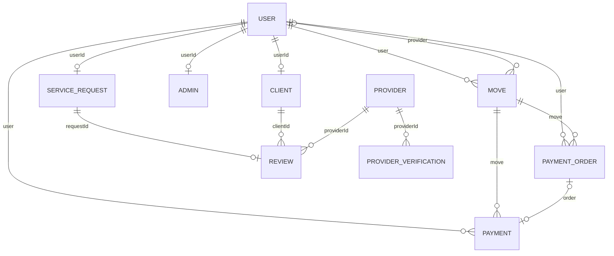

# SwiftMove Database Documentation (As Built)

MongoDB is accessed through Mongoose. Fields below reflect declared schemas, not a live database inspection. Mongoose-managed `_id` exists on documents; schemas with `{ timestamps: true }` also receive `createdAt` and `updatedAt`. Collection names below are Mongoose's default model-name pluralization and were not confirmed against a live database.

## Operational collections

### `users` (`User.model.js`)

| Field | Type | Required/default/validation | References / notes |
|---|---|---|---|
| `name` | String | Required | |
| `email` | String | Required, unique index | Signup lowercases; schema does not specify lowercase/trim |
| `password` | String | Required | Hashed by pre-save hook using bcryptjs (10 salt rounds); excluded from admin/profile query responses |
| `role` | String | Enum `user`, `admin`, `mover`; default `user` | Signup only permits `user` or `mover`; admin provisioning is outside signup |
| `moverApprovalStatus` | String | Optional enum `pending`, `approved`, `rejected`; no schema default | New mover signup explicitly writes `pending`; omitted for customers/admins. Missing legacy value is treated as pending by authorization and admin review. |
| `moverReviewedBy` | ObjectId | Optional | Ref `User`; admin who made the decision |
| `moverReviewedAt` | Date | Optional | Decision timestamp |
| `moverReviewReason` | String | Optional, trimmed, max 500 chars | Required by the rejection API; surfaced only for rejected mover’s own auth/profile response and admin review |
| `phone` | String | Default empty string | |
| `createdAt`, `updatedAt` | Date | Automatic timestamps | |

Methods: `matchPassword(enteredPassword)`. No verified email or password-reset fields. Approval fields are meaningful only for `role: mover`.

### `moves` (`move.model.js`)

| Field | Type | Required/default/validation | References / notes |
|---|---|---|---|
| `user` | ObjectId | Required | Ref `User`; booking owner |
| `provider` | ObjectId | Default `null` | Ref `User`; assigned mover |
| `pickup` | Embedded object | No required nested fields | `address: String`, `city: String`; current booking stores resolved address |
| `dropoff` | Embedded object | No required nested fields | `address: String`, `city: String` |
| `service` | String | Enum `warehousing`, `freight`, `packaging`, `delivery`, `custom` | Not schema-required, but booking service validates it |
| `weight` | Number | Minimum `0.001` | Not schema-required; booking service requires positive value; stored but not used in price formula |
| `loadingRequired`, `unloadingRequired` | Boolean | Default `false` | |
| `moveDate` | Date | Required | Controller validates parsability, not that date is future |
| `status` | String | Enum `requested`, `accepted`, `in_progress`, `completed`, `cancelled`; default `requested` | `cancelled` exists in schema but no cancel route |
| `price` | Number | Minimum `0`; optional | Current server-generated total for new bookings |
| `pricingStatus` | String | Enum `unpriced`, `priced`; default `unpriced` | Legacy/old records default unpriced |
| `pricing.currency` | String | Optional | |
| `pricing.distanceKm` | Number | Optional | |
| `pricing.routeProvider` | String | Optional | Current booking writes `geoapify` |
| `pricing.pickupResolved`, `pricing.dropoffResolved` | String | Optional | |
| `pricing.calculatedAt` | Date | Optional | |
| `pricing.breakdown.*` | Number | Optional | `baseBookingCharge`, `pricePerKilometre`, `distanceCharge`, `serviceCharge`, `loadingCharge`, `unloadingCharge`, `subtotal`, `minimumBookingCharge`, `minimumAdjustment`, `total` |
| `paid` | Boolean | Default `false` | |
| `payment` | ObjectId | Default `null` | Ref `Payment` |
| `paymentOrderLock` | Embedded lock | Optional; token/expiry fields hidden from normal selection | Conditional lease serializing order creation and payment verification across processes |
| `review.rating` | Number | Optional | No range validation in Move schema |
| `review.comment` | String | Optional | No current review workflow |
| `createdAt`, `updatedAt` | Date | Automatic timestamps | |

### `paymentorders` (`paymentOrder.model.js`)

| Field | Type | Required/default/validation | References / notes |
|---|---|---|---|
| `user` | ObjectId | Required, indexed | Ref `User` |
| `move` | ObjectId | Required, indexed | Ref `Move` |
| `amount` | Number | Required, minimum `0.01` | Stored in major currency units |
| `currency` | String | Required, uppercase, length 3 | |
| `gateway` | String | Enum `razorpay`, default `razorpay` | |
| `razorpayOrderId` | String | Required, unique/indexed | |
| `razorpayPaymentId` | String | Optional | |
| `razorpaySignature` | String | Optional, `select: false` | |
| `status` | String | Enum `created`, `paid`, `failed`; default `created`, indexed | No `refunded` state here |
| `createdAt`, `updatedAt` | Date | Automatic timestamps | |

### `payments` (`payment.model.js`)

| Field | Type | Required/default/validation | References / notes |
|---|---|---|---|
| `user` | ObjectId | Required, indexed | Ref `User` |
| `move` | ObjectId | Required, indexed | Ref `Move` |
| `order` | ObjectId | Optional, indexed | Ref `PaymentOrder` |
| `amount` | Number | Required, minimum `0` | Major currency units |
| `currency` | String | Optional, uppercase, length 3 | |
| `gateway` | String | Enum `razorpay`, `cash`; default `razorpay` | Current controller writes `razorpay` |
| `razorpayOrderId` | String | Required, indexed | |
| `razorpayPaymentId` | String | Required, unique/indexed | Duplicate transaction guard |
| `razorpaySignature` | String | Required, `select: false` | |
| `paymentStatus` | String | Enum `created`, `paid`, `failed`, `refunded`; default `paid` | Current successful controller writes `paid` |
| `releaseStatus` | String | Enum `held`, `released`; default `held` | No release/payout workflow found |
| `createdAt`, `updatedAt` | Date | Automatic timestamps | |

## Legacy or disconnected collections

These schemas are present but are not imported by mounted controllers and do not have active persistence workflows in the current application.

### `orders` (`order.model.js`)

`user: ObjectId` required ref `User`; `pickup: String` required; `dropoff: String` required; `moveDate: Date` optional; `service: String` required enum `warehousing|freight|packaging|delivery|custom`; `price: Number` required; `status: String` enum `pending|paid|assigned|completed|cancelled`, default `pending`; timestamps enabled. It is a different model from current `Move` bookings.

### `clients` (`client.model.js`)

`userId: ObjectId` required/unique ref `User`; `address: String` required; `city: String` required; `pincode: String` required. No timestamps declared. No mounted workflow creates or reads this model.

### `admins` (`admin.model.js`)

`userId: ObjectId` required/unique ref `User`. No timestamps. Current admin authorization relies on `User.role`, not this collection.

### `servicerequests` (`ServiceRequest.model.js`)

`userId: ObjectId` required ref `User`; `serviceType: String` required; `status: String` enum `created|connected|stored|shipped|delivered`, default `created`; timestamps enabled. Route module is unmounted; its placeholder handler does not persist a record.

### `reviews` (`Review.model.js`)

`requestId: ObjectId` required/unique ref `ServiceRequest`; `clientId: ObjectId` required ref `Client`; `providerId: ObjectId` required ref `Provider`; `rating: Number` required, min 1, max 5; `comment: String` optional; timestamps enabled. Review route is unmounted and only returns a static message.

### `providerverifications` (`providerVerfication.js`)

`providerId: ObjectId` required ref `Provider`; `adminUserId: ObjectId` optional ref `User`; `status: String` enum `pending|verified|rejected`, default `pending`; `remarks: String` optional; timestamps enabled. No controller/workflow uses it. No unique provider constraint is declared.

### Conflicting `Provider` model registrations

Both `Service.model.js` and `ServiceProvider.model.js` call `mongoose.model("Provider", ...)`, but declare different fields. If both modules are loaded into the same Mongoose process, the second registration can raise `OverwriteModelError` (unless model registration behavior is changed). Neither is imported by the current mounted operational controllers. `ProviderVerification` and `Review` refer to the model name `Provider`, making their intended target ambiguous.

`Service.model.js` has no timestamps and declares `userId` (ObjectId ref `User`, required/unique), `companyName` (String required), `licenseNo` (String required/unique), `serviceAreas` (String array), `availabilityStatus` (Boolean default true), `avgRating` (Number default 0), and `totalJobsCompleted` (Number default 0). Despite the filename, it registers model `Provider`.

`ServiceProvider.model.js` declares the same fields (and same `Provider` model name) but has no timestamps. It also registers `Provider`.

## Relationships

The diagram includes declared references for legacy models and does not imply that those related records are currently created. `Provider` in the legacy part is ambiguous because of duplicate model declarations.

## Indexes and integrity notes

- Explicit uniqueness: User email; PaymentOrder Razorpay order ID; Payment Razorpay payment ID; Client/Admin userId; legacy Provider userId and license number; Review requestId.
- Explicit ordinary indexes: PaymentOrder user/move/status/order ID; Payment user/move/order/order ID/payment ID; some unique fields also set `index: true`.
- Mongoose may create schema indexes automatically depending on connection settings; production index build configuration was not inspected.
- No compound owner/status indexes are declared for Move queries. Conditional Move updates provide one short-lived per-Move payment-operation lease; it is renewed before persistence and expired leases recover after process failure. No database transaction spans PaymentOrder, Payment, and Move updates.
- `Payment.order` is not unique at the schema level. The controller and Move verification lock enforce intended single-payment behavior during normal requests; the database does not declare a unique one-payment-per-order or one-paid-payment-per-move constraint.
- No live MongoDB collection, data, index, migration, or referential-integrity state was inspected. Phase 1.2’s migration dry-run must be run only against an explicitly verified isolated staging database before apply.

## Mover approval migration and compatibility

The controlled script `Backend/scripts/migrateMoversToPending.js` targets only `users` documents with `role: "mover"` and missing approval/review fields. It updates only `moverApprovalStatus` to `pending`. It does not update User IDs, passwords, names, emails, phone, roles, Move provider references, Move status, payments, or historical data. Its default mode is dry-run; apply requires explicit staging confirmation and `--apply --confirm-pending-mover-review`. It is not run at server startup.

Before applying, the script inventories mover count, eligible-for-pending count, current decision counts, assigned Move counts by status, all assigned provider references grouped by User role/orphan state, and unassigned requested moves. It refuses apply when it finds inconsistent approval metadata. Idempotence comes from filtering for absent status and review fields; re-running after migration does not overwrite reviewed or already-pending accounts. An actual database inventory or migration execution is not asserted by this documentation.
